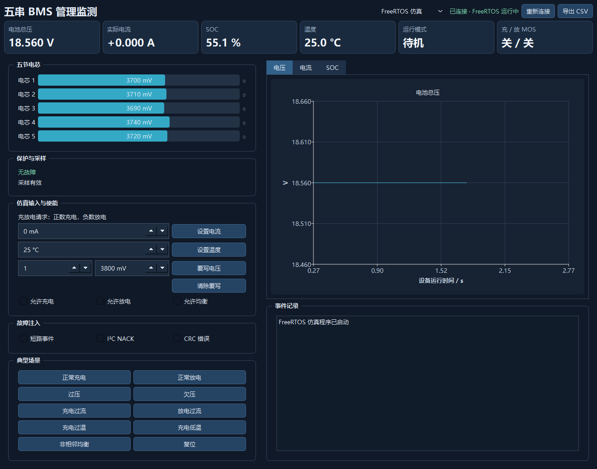
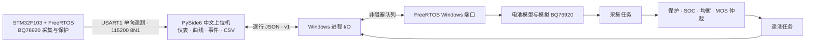
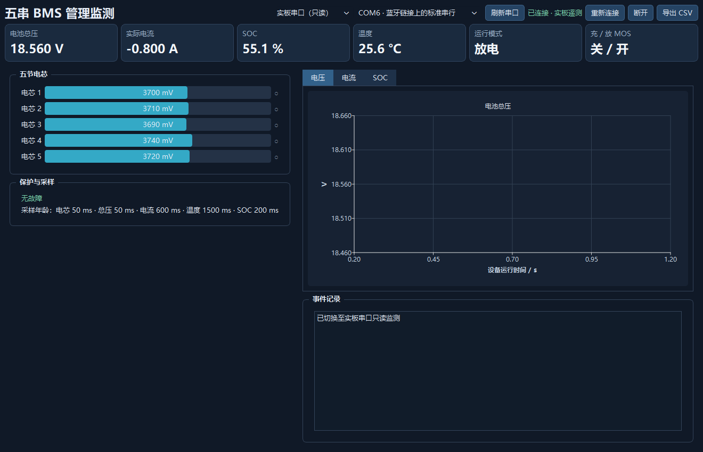

# BMS FreeRTOS Simulator

**五串电池管理系统仿真、保护逻辑验证与 Windows 实时监测上位机。**

项目提供两种数据源：在电脑上运行的 FreeRTOS 仿真进程，以及通过 USART1 遥测帧连接的 STM32F103 实板。中文上位机统一展示电芯电压、总压、电流、温度、SOC、运行模式、充放电 MOS、均衡和故障状态，并记录实时曲线与 CSV 数据。仿真模式支持交互式设置和故障注入；实板串口模式**只读监测**，不向电池板发送控制命令。



> 当前状态：Windows 仿真及自动测试已通过，STM32 固件已完成编译和链接。实板烧录、接线与电气性能仍需用硬件验证。界面截图和演示数据不能作为电池实测结果。

## 功能概览

| 功能 | FreeRTOS 仿真 | 实板串口监测 |
| --- | --- | --- |
| 五节电芯、总压、电流、温度、SOC、模式与故障展示 | 支持 | 支持，按字段有效性显示 |
| 电压、电流、SOC 实时曲线与 CSV 导出 | 支持 | 支持 |
| 充放电、温度、电芯电压覆写、均衡设置 | 支持 | 只读，不提供控制 |
| 过压、欠压、过流、短路及采集错误演示 | 支持 | 显示板端上报的状态 |
| 断连、数据过期和通信异常提示 | 支持 | 支持，含 CRC 与序号检查 |

### 软件结构



电脑仿真程序使用固定的 **FreeRTOS Kernel V11.3.1 Windows 端口**。采集、控制、电池演化和遥测由 FreeRTOS 任务调度；桌面界面通过 `QProcess` 启停进程。板端固件使用同版内核的 Cortex-M3 端口，低优先级任务约每 200 ms 发送一帧状态。

## 快速开始：Windows 仿真

### 环境要求

- Windows 电脑与 PowerShell
- Python 3.13；Python 依赖见 [`requirements.txt`](requirements.txt)，当前为 PySide6 6.11.2
- Zig 0.17.0，用于编译 Windows 仿真程序

FreeRTOS 源码已放在 `third_party/FreeRTOS-Kernel`，运行时无需再下载内核。把 Zig 加入 `PATH`，或设置 `BMS_ZIG_EXE` 指向 `zig.exe`。

```powershell
cd BMS-FreeRTOS-Simulator
py -3.13 -m pip install -r requirements.txt
.\run.ps1
```

`run.ps1` 会先构建 `build/bms_sim.exe`，再启动上位机。如果 PowerShell 阻止脚本执行，可运行：

```powershell
powershell -ExecutionPolicy Bypass -File .\run.ps1
```

启动后选择 **FreeRTOS 仿真**。初始状态下充电、放电和均衡均未使能，可以按以下步骤看到数据变化：

1. 勾选“允许充电”，将电流设为 `1000 mA`，点击“设置电流”。正电流为充电，负电流为放电。
2. 观察电芯电压、SOC、运行模式、MOS 状态和曲线随时间变化。
3. 点击“典型场景”中的过压、欠压、过流、温度保护或非相邻均衡，观察故障与输出变化。
4. 点击“复位”回到默认状态；点击“导出 CSV”保存已经收到的遥测记录。

电芯电压覆写会持续生效，直到清除该覆写或复位。界面中的“请求电流”和“实际电流”不同：当保护逻辑关闭相应 MOS 时，实际电流会归零。

### 仿真范围

模型使用五串电芯、电流积分 SOC 和简化的电压变化；均衡通道会产生模拟放电。支持单体电压持续覆写、温度设置、充放电请求，以及短路事件、I²C NACK、CRC 错误注入。采样无效时控制逻辑停止使用旧测量值，并关闭充放电输出；恢复连续有效样本后才解除采样故障。多项保护故障分别保留，未全部解除时不会错误地重新导通受影响的 MOS。

| 仿真参数 | 默认值 |
| --- | ---: |
| 电芯数量 / 额定容量 | 5 串 / 2.2 Ah |
| 单体过压 / 恢复 | 4.20 V / 4.18 V |
| 单体欠压 / 恢复 | 3.10 V / 3.15 V |
| 充、放电过流判定阈值 | 2.2 A |
| 高温 / 恢复 | 70 °C / 60 °C |
| 低温 / 恢复 | −20 °C / −10 °C |
| 均衡起点 / 最小压差 | 3.30 V / 50 mV |

上述数值是**仿真默认参数**，并非对任意电芯或电池包的使用建议。短路在仿真中作为故障事件注入，不代表硬件短路响应时间。

## 实板串口监测

上位机也可以接收本项目 STM32F103C8T6 固件上报的 BMS 状态。实板模式只接收数据，界面会隐藏仿真输入、控制和故障注入操作。字段尚未确认、采样失败或超过 1 秒未收到有效帧时，界面会显示未知或“数据过期”，避免将旧数据当作实时值。



*上图用于展示串口模式布局，数据来自测试用模拟串口流，不是实板实测。*

### 接线

板端使用 **USART1 / TX1 / PA9，115200 baud、8N1**。烧入本项目的板端固件后，按实际控制板原理图和丝印核对引脚，再连接 USB 转串口适配器：

```text
STM32 控制板 TX1 (PA9) ───────> USB 转串口 RX
STM32 控制板 GND       ───────> USB 转串口 GND
```

串口模式为单向只读，适配器 TX 无需连接。接线前先核对适配器与控制板的串口电平；不要将适配器供电端直接接到电池板。普通文本调试输出不能按本项目的二进制遥测协议解析。

在上位机选择“实板串口（只读）”，点击“刷新串口”，选择对应 COM 端口，再点击“重新连接”。拔线、端口被占用、CRC 错误、协议版本不匹配和序号缺口会在连接状态或事件记录中提示；重新连接会清空上一段实时曲线。

### 板端固件构建

安装 [Arm GNU Toolchain](https://developer.arm.com/Tools%20and%20Software/GNU%20Toolchain)，确保 `arm-none-eabi-gcc` 在 `PATH` 中，或将 `BMS_ARM_GCC_BIN` 指向工具链的 `bin` 目录。本项目使用 **14.3.rel1** 完成 Windows 构建验证。建议使用纯英文安装路径。

```powershell
$env:BMS_ARM_GCC_BIN = 'C:\path\to\arm-gnu-toolchain\bin'
.\build-board.ps1
```

输出位于 `build/board/`：

| 文件 | 用途 |
| --- | --- |
| `bms_board.elf` | 调试与符号信息 |
| `bms_board.bin` | 烧录镜像 |
| `bms_board.map` | 链接映射 |
| `size.txt` | ELF 的 text / data / bss 大小 |

链接脚本按 STM32F103C8T6 的 **64 KiB Flash / 20 KiB RAM** 限制检查，构建时也会打印内存区域用量。构建成功仅说明源码可以编译链接；上板启动、I²C 采样、串口电平和实际保护时序尚未完成硬件验证。

### 串口帧与数据有效性

固件约每 200 ms 发出一帧 49 字节的版本化二进制状态帧，包含同步字、版本、类型、长度、序号、运行时间、载荷和 CRC-16。载荷记录五节电压、总压、电流、温度、SOC、模式、故障位、均衡位、MOS 读回、字段有效位与采样年龄。电流、温度等字段保留各自的实际采样周期，不因遥测发送周期而伪装为新采样值。

上位机会处理串口拆包、粘包和坏帧重同步，并按有效位决定字段是否可展示。完整字段、字节序和故障位定义见 [实板串口协议文档](docs/BOARD_SERIAL_PROTOCOL.md)。

## 仿真进程协议

桌面界面与 Windows 仿真进程使用 **UTF-8 逐行 JSON（NDJSON），协议版本 `v=1`**。每个输入命令携带整数 `id` 与字符串 `type`，进程返回对应的 `ack`，并发送事件与约每 200 ms 一次的状态快照。

```json
{"v":1,"id":1,"type":"set_enable","charge":true,"discharge":true,"balance":false}
{"v":1,"id":2,"type":"set_current","ma":1000}
```

| 命令 | 主要字段 |
| --- | --- |
| `set_current` | `ma`：−5000 至 5000 |
| `set_cell` | `index`：1 至 5；`mv`：2500 至 4400，或 `null` 清除覆写 |
| `set_temp` | `c`：−40 至 100 |
| `set_enable` | `charge`、`discharge`、`balance`：布尔值 |
| `inject_fault` | `kind`：`scd`、`nack`、`crc`；`on`：布尔值 |
| `reset` / `ping` | 无额外字段 |

快照包含五节电压、总压、请求与实际电流、温度、SOC、模式、MOS 状态、均衡位图、故障位和采样有效性。**该 JSON 协议只用于仿真进程，不发送到实板串口。**

## 验证

运行以下命令执行仿真核心、进程协议、串口协议和界面相关测试：

```powershell
.\build.ps1 -Tests
```

现有测试覆盖过压、欠压、充放电过流、温度保护、短路事件、采集失败与恢复、组合故障、非相邻均衡及退出；还覆盖异常命令、串口 CRC/版本/长度错误、随机分块、序号缺口、数据过期、模拟拔线、重连和 CSV 导出。界面启动也经过检查。

Windows FreeRTOS 端口不保证硬件实时性；简化电池模型不拟合热特性、老化或未经校准的 SOH/SOP。项目尚无实板烧录与串口联调结果，也不提供可据此评价电池安全性能的测试数据。

## 目录

```text
BMS-FreeRTOS-Simulator/
├─ src/                     # Windows FreeRTOS 仿真、业务核心与 JSON 协议
├─ desktop/                 # PySide6 界面与串口帧解析
├─ board/stm32f103/         # STM32F103C8T6 FreeRTOS 板端固件
├─ docs/                    # 界面截图与实板串口协议
├─ tests/                   # 核心、协议与界面测试
├─ third_party/FreeRTOS-Kernel/
├─ build.ps1                # 构建 Windows 仿真；-Tests 执行测试
├─ build-board.ps1          # 构建板端 ELF / BIN / MAP
└─ run.ps1                  # 一键构建并启动上位机
```

## 许可与致谢

FreeRTOS、STM32 HAL、CMSIS、PySide6 及项目中改编代码的来源和许可要求见 [NOTICE.md](NOTICE.md) 与 [LICENSE-ORIGINAL](LICENSE-ORIGINAL)。其中原始素材包含非商业使用条款；使用或分发本项目时请先核对相关许可。
